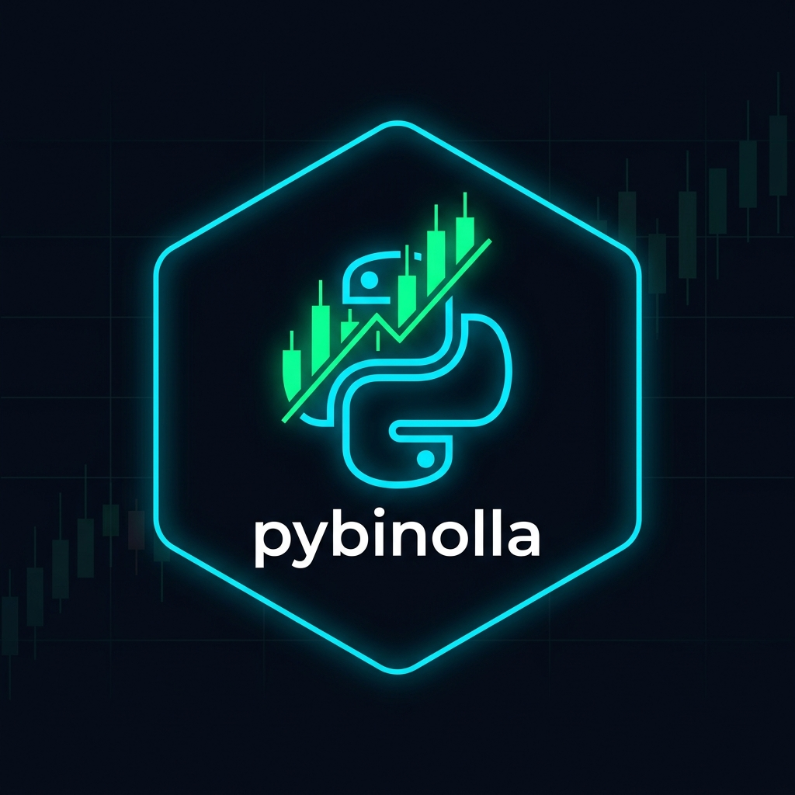

# pybinolla — Python API for Binolla Binary Options

<p align="center">
  
</p>

<p align="center">
  <a href="https://www.python.org/"></a>
  <a href="https://binolla.com"></a>
  <a href="#"></a>
  <a href="LICENSE"></a>
  <a href="#"></a>
  <a href="https://t.me/llldevl"></a>
</p>

<p align="center">
  <b>The #1 open-source Python library for the <a href="https://binolla.com">Binolla</a> binary options trading platform.</b><br/>
  Automate · Stream · Analyze · Trade on Demo — all from Python.
</p>

> **pybinolla** is the first and only open-source Python library that gives developers full programmatic access to the [Binolla](https://binolla.com) trading platform.
> Built on `asyncio`, Socket.IO v4, and a Cloudflare-aware session engine — giving you real-time market data, historical candles, and demo trading automation in just a few lines of Python.

---

## 🔥 Why pybinolla?

- ⚡ **Async-first** — built on `asyncio` for high-frequency, non-blocking trading
- 📡 **Real-time WebSocket streaming** — live price ticks at ~3 ticks/second via Socket.IO v4
- 📊 **Full candle history** — fetch M1, M5, M15, M30, H1 OHLC data for any asset
- 🔐 **Cloudflare bypass** — automatic TLS cipher spoofing and browser session emulation
- 💾 **Session caching** — saves your JWT token so you don't re-login every run
- 🤖 **Bot-ready architecture** — event-driven, clean class API, mirrors industry standards
- 🆓 **Free & open-source** — MIT license, forever free for demo trading and data

---

## ⚡ Features: Community Edition vs Pro

| Feature | 🆓 Community (Free) | 💎 Pro Edition |
| :--- | :---: | :---: |
| **Platform Login & Cloudflare Bypass** | ✅ | ✅ |
| **Session Persistence** | ✅ | ✅ |
| **Real-time Price Streaming** | ✅ ~3 ticks/s | ✅ Ultra-low latency |
| **Historical Candle Data (M1→H1)** | ✅ | ✅ All + Tick-level |
| **Demo Account Trading** | ✅ Unlimited | ✅ Unlimited |
| **Balance Queries** | ✅ | ✅ |
| **Real Account Live Trading** | ❌ Pro Only | 🔥 Full Support |
| **Blitz / Turbo Expirations (5s–30s)** | ❌ Pro Only | 🔥 5s / 10s / 15s / 30s |
| **Payout % Live Filter (>85%)** | ❌ Pro Only | 🔥 Automated |
| **Copy Trading Engine** | ❌ Pro Only | 🔥 Multi-account |
| **Martingale & Stop-Loss Helpers** | ❌ Pro Only | 🔥 Automated |
| **Auto-Reconnect Watchdog** | Basic | 🔥 Zero-downtime |

> 💎 **Interested in pybinolla Pro?**  
> Unlock Real Account Live Trading, Turbo/Blitz Modes, Auto-Payout Filters, and Copy Trading.  
> 📩 Contact directly on Telegram: **[@llldevl](https://t.me/llldevl)** or open a GitHub inquiry.

---

## 📦 Installation

```bash
# 1. Clone the repository
git clone https://github.com/bahadjdz/pybinolla.git
cd pybinolla

# 2. Install dependencies
pip install -r requirements.txt

# 3. (Optional) Install as an editable package
pip install -e .
```

**Requirements:** Python 3.10+, pip

---

## 🚀 Quick Start

### Connect & Get Balance

```python
import asyncio
from pybinolla import Binolla, AccountType

async def main():
    client = Binolla(email="your@email.com", password="yourpassword")

    ok, reason = await client.connect(account=AccountType.DEMO)
    if not ok:
        print("Login failed:", reason)
        return

    bal = await client.get_balance()
    print(f"Demo Balance: ${bal.demo_balance:.2f}")

    await client.close()

asyncio.run(main())
```

### Fetch Historical Candles (EURUSD, 1-minute)

```python
import asyncio
from pybinolla import Binolla, Period, AccountType

async def main():
    client = Binolla(email="your@email.com", password="yourpassword")
    await client.connect(account=AccountType.DEMO)

    # Fetch last 100 M1 candles for EUR/USD OTC
    candles = await client.get_candles("EURUSD_otc", count=100, period=Period.M1)
    print(f"Got {len(candles)} candles")
    print(f"Latest: O={candles[-1].open} H={candles[-1].high} L={candles[-1].low} C={candles[-1].close}")

    await client.close()

asyncio.run(main())
```

### Place a Demo Trade & Await Result

```python
import asyncio
from pybinolla import Binolla, Direction, Period

async def main():
    client = Binolla(email="your@email.com", password="yourpassword")
    await client.connect()

    # Place $1 CALL on EURUSD_otc, 1-minute expiry
    order_id = await client.buy(
        asset="EURUSD_otc",
        direction=Direction.CALL,
        amount=1.0,
        period=Period.M1
    )
    print(f"Order placed: {order_id}")

    # Wait for the trade to settle
    result = await client.wait_for_result(order_id, timeout=90)
    if result:
        print(f"{'WIN 🎉' if result.win else 'LOSS ❌'} | PnL: ${result.profit:+.2f}")

    await client.close()

asyncio.run(main())
```

### Stream Live Price Ticks

```python
import asyncio
from pybinolla import Binolla, Period

async def main():
    client = Binolla(email="your@email.com", password="yourpassword")
    await client.connect()

    await client.start_stream("EURUSD_otc", period=Period.M1)

    for _ in range(20):
        tick = await client.get_realtime_candle("EURUSD_otc")
        if tick:
            print(f"Price: {tick}")
        await asyncio.sleep(1)

    await client.close()

asyncio.run(main())
```

---

## 🏗️ Project Structure

```
pybinolla/
├── pybinolla/
│   ├── __init__.py          # Public API exports
│   ├── client.py            # Binolla — main high-level client class
│   ├── api.py               # BinollaAPI — WebSocket + HTTP orchestration
│   ├── websocket_client.py  # Socket.IO v4 wire-level engine
│   ├── http_client.py       # Cloudflare bypass + TLS cipher adapter
│   ├── connection.py        # Connection state machine + async helpers
│   ├── event_registry.py    # Async event bus (key-value futures)
│   ├── candles.py           # Tick aggregation & OHLC candle parser
│   ├── models.py            # Candle, Balance, Order, OrderResult dataclasses
│   ├── enums.py             # Direction, AccountType, Period enums
│   └── exceptions.py        # BinollaConnectionError, BinollaProFeatureError
├── examples/
│   ├── 01_get_balance.py    # Balance retrieval
│   ├── 02_fetch_candles.py  # Historical candle data
│   ├── 03_stream_quotes.py  # Live price streaming
│   └── 04_demo_trade.py     # Demo trade + result
├── requirements.txt
├── pyproject.toml
├── LICENSE                  # MIT
└── README.md
```

---

## 🔌 Binolla WebSocket Protocol

pybinolla communicates directly with Binolla's private WebSocket cluster:

| Step | Detail |
| :--- | :--- |
| **Endpoint** | `wss://ws3.binolla.com/socket.io/?EIO=4&transport=websocket` |
| **Protocol** | Engine.IO 4 / Socket.IO v4 |
| **Auth payload** | `42["authorization", {"token": "<JWT>", "userAccountType": 1}]` |
| **Candle request** | `42["history/region", {"asset": "EURUSD_otc", "period": 60, ...}]` |
| **Quote stream** | `42["s_quotes/list", [["EURUSD_otc", timestamp, price, 1]]]` |
| **Order open** | `42["orders/open", {"asset": ..., "amount": 1, "cmd": 0, "time": expiry}]` |
| **Settlement** | `42["s_orders/close", {"profit": ..., "deals": [...]}]` |

---

## 🛠️ Supported Assets & Periods

**Periods:** `M1` (60s) · `M5` (300s) · `M15` (900s) · `M30` (1800s) · `H1` (3600s)

**Asset examples:** `EURUSD_otc` · `GBPUSD_otc` · `USDJPY_otc` · `AUDCAD_otc` · and 50+ more

---

## ❓ FAQ

**Q: Does pybinolla work with a real Binolla account?**
> Real account trading is available in **pybinolla Pro** only. Contact [@llldevl](https://t.me/llldevl) on Telegram for licensing. The free edition fully supports demo trading and market data.

**Q: Do I need a Binolla account?**
> Yes. Create a free account at [binolla.com](https://binolla.com) and use your email/password.

**Q: Is this safe to use?**
> pybinolla only communicates with Binolla's official servers using the same protocol as the web platform. Never share your credentials in code.

**Q: Can I build a trading bot with this?**
> Absolutely. The async event-driven architecture is designed for bot development.

---

## ⚠️ Disclaimer

This is an **unofficial**, community-built library and is not affiliated with or endorsed by Binolla.  
Binary options trading carries a **high risk of financial loss**. Always test on a demo account first.  
The authors accept no liability for financial losses from use of this software.

---

## 📄 License

**MIT License** — free to use, modify, and distribute. See [`LICENSE`](LICENSE) for details.

---

## 🔎 Search Tags

`binolla` `binolla-api` `binolla-python` `binolla-bot` `binolla-trading-bot` `binolla-websocket`
`binary-options` `binary-options-python` `binary-options-bot` `binary-options-api`
`pybinolla` `python-trading-bot` `asyncio-trading` `trading-automation`
`forex-bot` `otc-trading` `demo-trading-bot` `websocket-trading`
